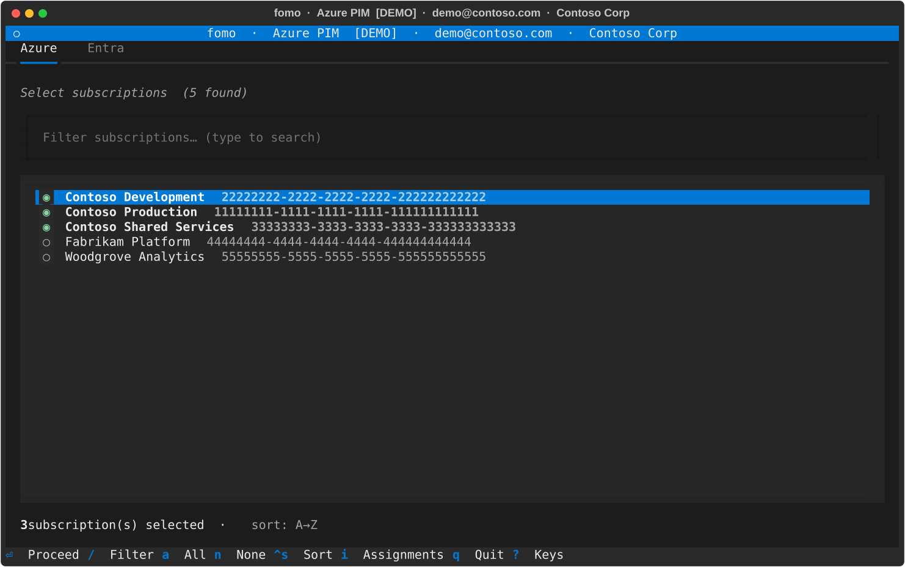
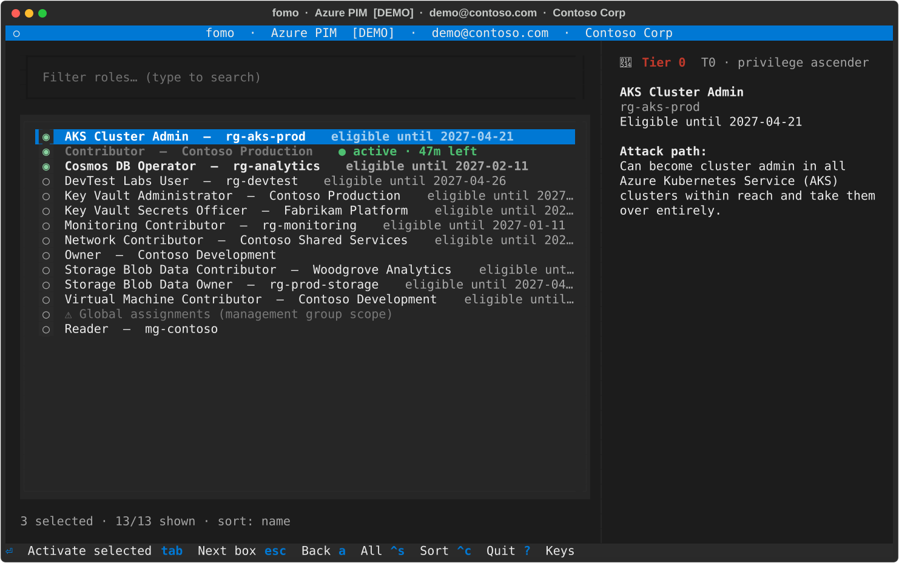
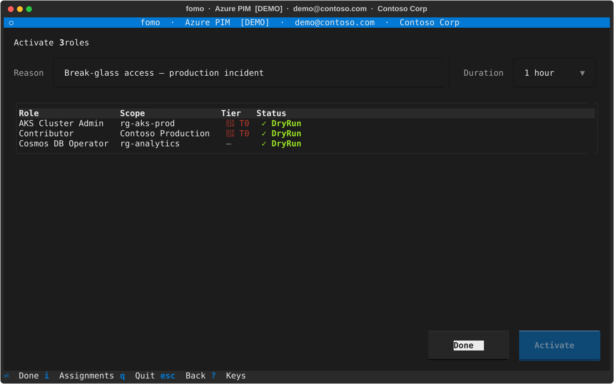
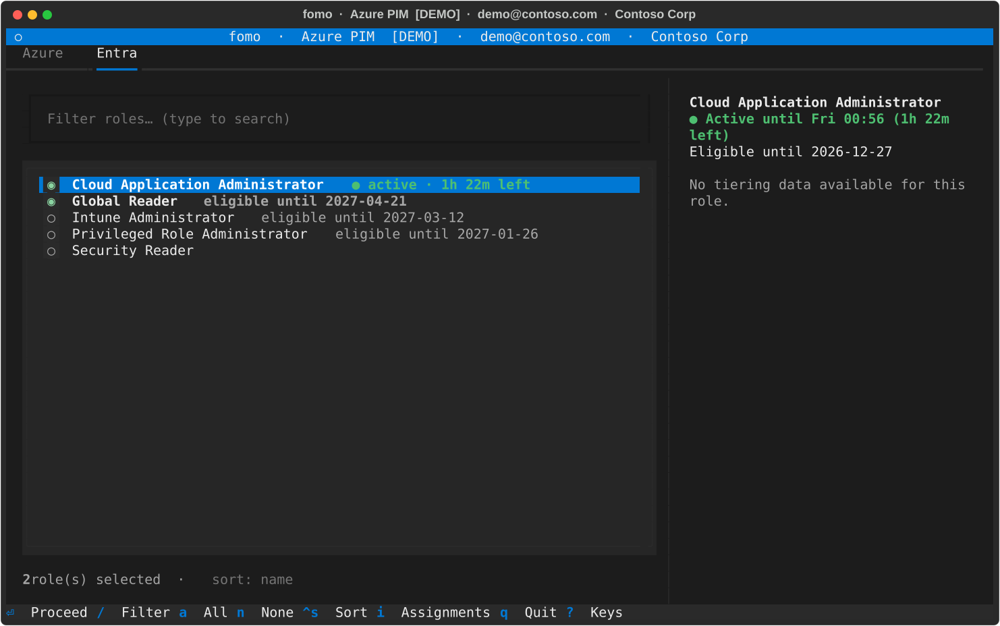

# fomo

A terminal UI for activating Azure PIM eligible roles with multiselect.

## Features

- **Multiselect activation** — pick multiple eligible roles across subscriptions in one go
- **Azure RBAC & Entra roles** — supports both subscription/resource-scoped PIM roles and Entra directory roles (Global Administrator, etc.)
- **Management group scope** — activate roles at management group level (CLI only, with `--mg`; the TUI has no management-group picker)
- **Batch activation** — all selected roles are submitted in one go, one after another (not in parallel), with per-role progress tracking
- **Non-interactive CLI mode** — skip the TUI with `-r`/`--reason` for scripting and automation
- **Dry-run mode** — simulate activation without making any real API calls
- **Cached Entra token** — the Microsoft Graph refresh token is cached at `~/.cache/fomo/graph_token.json`, so the device code sign-in is only needed again when that refresh token expires
- **Blast-radius tiers** — roles are tagged with their privilege tier from the public [azure-tiering](https://github.com/emiliensocchi/azure-tiering) data set
- **Verbose logging** — write full API call/response logs to a file for troubleshooting

## Screenshots

### Subscription / Entra tab



### Role selection



### Activation



### Entra roles tab



## Authentication

fomo uses two separate sign-ins:

- **Azure RBAC (ARM) calls** go through `az rest` and use your existing `az login` session. fomo never sees those credentials.
- **Entra roles** are managed through Microsoft Graph, which needs a scope that the `az` first-party app doesn't have. fomo runs its own OAuth 2.0 device code sign-in for this and caches the resulting refresh token in `~/.cache/fomo/graph_token.json` (mode `0600`). Later runs reuse it silently. When the refresh token expires, the device code prompt comes back. To force a fresh sign-in (for example to switch account or tenant), delete that file.

## Network access

Besides Azure Resource Manager and Microsoft Graph, fomo downloads blast-radius tier data from the public [`emiliensocchi/azure-tiering`](https://github.com/emiliensocchi/azure-tiering) GitHub repository (via `raw.githubusercontent.com`). The data is pinned to a specific upstream commit, so the tier labels change only with a fomo release, not whenever the upstream repository changes. The data is cached for 7 days in `~/.cache/fomo/` (`tiering_azure.json`, `tiering_entra.json`). If a refresh fails, for example offline, fomo keeps using the older cached copy. Tier data is optional: if it can't be loaded, roles still load without tier badges. Demo mode (`--demo`) makes no network calls and uses only that cache.

## Platform support

Works on Linux, macOS, and WSL (Windows Subsystem for Linux).

## Prerequisites

- [Azure CLI](https://learn.microsoft.com/en-us/cli/azure/install-azure-cli) (`az`) — logged in with `az login`
- Python ≥ 3.11
- [`uv`](https://docs.astral.sh/uv/) or [`pipx`](https://pipx.pypa.io/)

## Install

**Using uv (recommended):**

```sh
uv tool install git+https://github.com/jvik/fomo
```

**Using pipx:**

```sh
pipx install git+https://github.com/jvik/fomo
```

**From a specific release wheel** (find the versioned `.whl` on the [releases page](https://github.com/jvik/fomo/releases/latest)):

```sh
uv tool install https://github.com/jvik/fomo/releases/latest/download/fomo-VERSION-py3-none-any.whl
```

## Update

**Using uv:**

```sh
uv tool upgrade fomo
```

**Using pipx:**

```sh
pipx upgrade fomo
```

## Usage

```sh
fomo
```

### Azure roles

1. Select a subscription scope
2. Multiselect the eligible roles to activate
3. Enter a justification and confirm — the roles are activated one after another, each with its own status row

### Entra roles

1. Switch to the **Entra** tab with `l` (or left/right arrow keys on the tab bar)
2. The app fetches your eligible directory roles via Microsoft Graph (first use, and any use after the cached refresh token has expired, requires a **device code** browser sign-in; see [Authentication](#authentication))
3. Multiselect the roles to activate (already-active roles are marked)
4. Choose a duration, enter a justification, and confirm

`fomo --entra` opens the TUI directly on the Entra tab.

Press `i` on the first screen to see your currently active Azure and Entra assignments.

Management-group activation isn't available in the TUI; use the CLI's `--mg` (see below).

**Dry-run mode** (no real API calls):

```sh
fomo --dry-run
```

**Verbose logging** (write debug logs to a file):

```sh
fomo --log /tmp/fomo.log
```

Logs include all `az rest` and Graph API calls and responses. Useful for troubleshooting.

### Non-interactive (CLI) mode

Skip the TUI entirely by providing `-r`/`--reason` on the command line.

Matching rules:

- **Roles:** an exact role name (case-insensitive) wins. Otherwise every role whose name contains the text is activated.
- **Subscriptions:** match by name substring or exact ID (both case-insensitive), and every matching subscription is used. Roles inherited from a parent management group (scoped outside the matched subscriptions) are skipped.
- **Management groups (`--mg`):** match by display-name substring or exact ID (case-insensitive); if more than one group matches, fomo exits with an error. Roles inherited from a parent management group are kept.
- Roles that are already active are skipped.

Matching roles are activated one after another, not in parallel.

**Azure RBAC (subscription scope)** — provide `SUBSCRIPTION` and `ROLE` as positional arguments:

```sh
fomo my-sub "Key Vault Administrator" -r "Break-glass access" -t 1h
```

**Management group scope** — use `--mg` with the management group name:

```sh
fomo --mg my-mg "Reader" -r "Audit review" -t 30m
```

**Entra ID roles** — use `--entra` with the role name:

```sh
fomo --entra "Global Reader" -r "Audit review" -t 1h
```

The `-t`/`--time` flag accepts ISO 8601 durations (`PT1H`, `PT30M`) or shorthand (`1h`, `30m`). Defaults to `PT1H`.

All three forms respect `--dry-run` to simulate activation without API calls.

> **Warning:** `--demo` only affects the TUI. Combined with `-r`/`--reason` it is currently ignored, so the command talks to Azure and **performs a real activation**. Use `--dry-run` to simulate a CLI activation.

## Development

Clone the repo and install dependencies (including dev tools) into a local virtualenv:

```sh
git clone https://github.com/jvik/fomo.git
cd fomo
uv sync --group dev
```

Run from source:

```sh
uv run fomo              # full app — requires `az login` and PIM-eligible roles
uv run fomo --dry-run    # real data, simulated activation (no write calls)
uv run fomo --demo       # dummy data, no Azure account needed
```

Run tests:

```sh
uv run pytest
```

See [CONTRIBUTING.md](CONTRIBUTING.md) for conventions and commit message guidelines.

